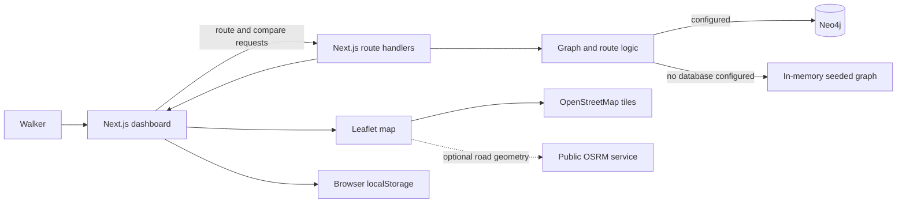

# JoyWalk

### A little more wonder in the way there.

JoyWalk is a mood-aware walking route prototype for Delhi NCR. It asks a simple question that most navigation apps skip: **what kind of walk would feel good right now?**

Choose where you want to start and end, pick a vibe, and JoyWalk compares ways to get there using modelled distance, tree canopy, ambient sound, and small points of interest. It is designed to make the trade-offs visible: perhaps a route takes a few more minutes, but passes through greener, quieter streets and a place worth pausing for.

This project is a hackathon prototype exploring the theme **“Joy with Technology.”** It is not a live navigation service, a source of measured environmental data, or a clinical wellbeing tool.

---

## Start here

The app lives in [`Frontend/ecoroute`](./Frontend/ecoroute).

### Requirements

- Node.js **20.9 or newer**
- npm
- A modern browser with an internet connection for map tiles and optional road-following geometry

Neo4j is optional for the local demo. Without database credentials, the app uses its bundled in-memory Delhi NCR graph and sample Joy Pins.

### Run locally

```bash
cd Frontend/ecoroute
npm install
npm run dev
```

Open [http://localhost:3000](http://localhost:3000). The dashboard loads a Gurgaon Cyber Green Promenade → Connaught Place walk so you can explore the experience right away.

### Production build

```bash
cd Frontend/ecoroute
npm run build
npm start
```

### Code checks

```bash
cd Frontend/ecoroute
npm run lint
```

The repository currently has no dedicated automated test script. The `scripts/` directory contains small diagnostic and route-check scripts used during development.

---

## Take a walk through the app

1. **Choose two havens.** Use the searchable origin and destination controls, swap them, or start with a curated preset.
2. **Pick the feel of the walk.** Restorative, Cultural, Brisk Walk, and Contemplative moods influence which modelled corridors the Scenic Drift route prefers.
3. **Decide how much to wander.** The pacing-versus-serenity slider changes the balance between a direct path and the chosen mood’s corridor preferences.
4. **Calculate a route.** JoyWalk draws the selected route and shows its estimated time, distance, serenity score, canopy, ambient noise, and micro-moments.
5. **Explore the trade-off.** Expand the comparison below the route summary to see how the selected route differs from Fastest Walk. Turn on **Compare 3 Modes** for a full side-by-side look at Fastest, Shade Seeker, and Scenic Drift.
6. **Notice what’s nearby.** Open **Joy Pins** to browse sample pockets of joy, filter by category, like a place, or add a pin.
7. **Keep a small record.** Log a walk to update the Daily Journal stored in this browser.

The dashboard is designed to fit a desktop viewport, with independently scrollable controls and results. On smaller screens, the panels stack and the page scrolls normally.

---

## What makes a route?

The routing engine runs Dijkstra’s shortest-path algorithm on a predefined network of Delhi NCR havens and connecting corridors. Each corridor has a distance and modelled wellbeing attributes.

### Fastest Walk

“Fastest” means **shortest distance on the prototype graph**. It does not use live traffic, turn-by-turn pedestrian travel times, or real-time conditions.

### Shade Seeker

This mode favours corridors with stronger modelled canopy. It uses a soft preference rather than a guarantee that every corridor on the route is above a particular measured shade threshold.

### Scenic Drift

Scenic Drift adjusts corridor costs using the selected mood:

| Mood shown in the UI | Routing mood ID | What its model favours |
| --- | --- | --- |
| Restorative | `Stressed` | Lower-noise, greener corridors |
| Cultural | `Curious` | Corridors with more modelled joy moments |
| Brisk Walk | `Energetic` | A brisker balance of distance and corridor conditions |
| Contemplative | `Reflective` | Quiet, shaded corridors with fewer distractions |

The serenity slider scales the mood preference relative to distance. These are prototype heuristics—not validated measures of happiness, accessibility, safety, or mental health.

### What the numbers mean

- **Distance** is calculated across graph edges whose lengths are derived from the haversine distance between seeded coordinates.
- **Walking time** is estimated from route distance at a fixed pace of 4.8 km/h.
- **Canopy, noise, and joy moments** are modelled corridor attributes in the bundled dataset.
- **Serenity score** is a prototype composite based on route canopy, noise, and joy-moment estimates. It is not a scientific or clinical score.
- **Road shape on the map** may be fetched separately from a public OSRM routing service. It is a visual geometry layer and does not change the graph route’s distance or metrics. If road geometry is unavailable, the map falls back to connecting graph checkpoints.

These values should be read as a demonstration of how a walking planner might explain trade-offs—not as measurements of current street conditions.

---

## Features

### Mood-aware route planning

Search across Delhi NCR havens, choose a walking mood, and adjust the balance between a direct route and a more restorative one. Curated presets make it easy to try the experience without knowing the dataset.

### Compare route strategies

View Fastest Walk, Shade Seeker, and Scenic Drift together. The map shows their route overlays; the results let you compare distance, estimated time, canopy, ambient noise, joy moments, and serenity score.

### Pockets of Joy

Joy Pins are small community-style place notes—shaded nooks, street art and music, sunset views, and independent coffee or chai spots. The bundled pins are **sample data**. Users can add a pin, like a pin, or select it to inspect it on the map.

### Golden Hour simulation

The Golden Hour control demonstrates how changed corridor conditions could influence the route planner. It is a simulation, not a live sun-position, weather, or air-quality feed.

### Daily Serenity Journal

Log a planned walk to record its estimated shaded kilometres and micro-moments. Journal entries are stored in the browser’s `localStorage`; they are not synced to an account or across devices.

---

## How the pieces fit together



The dashboard is a client-rendered Next.js App Router page. API route handlers call the shared graph logic. When Neo4j is configured, graph reads and supported writes use it; otherwise the route engine falls back to the data bundled with the app. The daily journal is a separate browser-local feature.

---

## Technology

- **Next.js 16** and **React 19** — application shell, dashboard, and API route handlers
- **Leaflet** and **React Leaflet** — interactive map, markers, popups, and route overlays
- **Neo4j JavaScript driver** — optional graph database integration
- **Tailwind CSS 4** — responsive styling and the forest-green JoyWalk theme
- **OpenStreetMap** — map tiles, with attribution shown on the map
- **OSRM public routing service** — optional road-following map geometry

No map API key is required for the configured OpenStreetMap tile layer. Map tiles and optional road geometry are third-party services and require network access.

---

## Optional Neo4j setup

To use a Neo4j database instead of the in-memory fallback, create `Frontend/ecoroute/.env.local`:

```env
NEO4J_URI=neo4j+s://<your-instance-id>.databases.neo4j.io
NEO4J_USER=<your-neo4j-username>
NEO4J_PASSWORD=<your-neo4j-password>
```

Restart the Next.js server after changing environment variables. Never commit `.env.local` or paste database credentials into issues or public logs.

### Seed the database (optional)

From the frontend directory:

```bash
node lib/seed-data.js
```

> **Important:** Seeding is destructive. The current seed routine deletes existing `Neighborhood`, `Rider`, and `JoyPin` nodes before inserting the demo network and sample pins. Do not run it against a database containing data you need to keep.

The seed data is defined in `lib/seed-data.js`; graph reads and route calculations are in `lib/graph-queries.js`.

---

## Project map

```text
EcoRoute/
├── README.md
├── Frontend/
│   └── ecoroute/
│       ├── app/
│       │   ├── api/
│       │   │   ├── compare/route.js
│       │   │   ├── golden-hour/route.js
│       │   │   ├── joy-pins/route.js
│       │   │   ├── neighborhoods/route.js
│       │   │   ├── route/route.js
│       │   │   └── wellbeing/route.js
│       │   ├── globals.css
│       │   ├── layout.js
│       │   └── page.js
│       ├── components/
│       │   ├── Controls.js
│       │   ├── JoyPinsPanel.js
│       │   ├── MapView.js
│       │   ├── MetricsPanel.js
│       │   ├── SearchableHavenInput.js
│       │   └── WellbeingMetricsPanel.js
│       ├── lib/
│       │   ├── graph-queries.js
│       │   ├── neo4j.js
│       │   └── seed-data.js
│       └── scripts/
└── workflows/
    └── aqi-simulator.ts
```

The repository still contains files from an earlier EcoRoute AQI/logistics prototype, including legacy API routes, components, and a background simulator. They are not the main JoyWalk experience described here; some of that older material may need updating or removal as the project evolves.

---

## Current boundaries and next steps

JoyWalk is an interactive prototype, and it is most useful when it is honest about that:

- The bundled Delhi NCR graph and its canopy, sound, and joy values are modelled demo data.
- Routes are computed over graph connections, not a complete verified pedestrian street network.
- Walking pace is fixed, and there is no live traffic, weather, air-quality, lighting, or accessibility feed.
- Joy Pins and Golden Hour can fall back to in-memory server state when Neo4j is not configured; that state may reset when the server restarts.
- The journal is local to one browser and can be cleared with browser storage.
- The app does not currently provide user accounts, cross-device sync, turn-by-turn directions, or a validated wellbeing outcome.

Good next steps would be to source and timestamp reliable street-level data, validate routes with local walkers, improve pedestrian-network coverage, add accessibility preferences, and make community contributions durable and moderated. Any wellbeing claims should be tested with people rather than inferred from a score.

---

## Contributing

For a focused change:

1. Work from the frontend package in `Frontend/ecoroute`.
2. Keep routing, graph data, map geometry, and presentation concerns separated.
3. Be explicit about whether data is measured, sourced, or simulated.
4. Run the production build and relevant lint checks:

   ```bash
   npm run build
   npm run lint
   ```

5. Describe any user-visible changes and their limitations in your pull request.

---

## License

No project license is currently specified. Until one is added, do not assume the code is available for unrestricted reuse.
